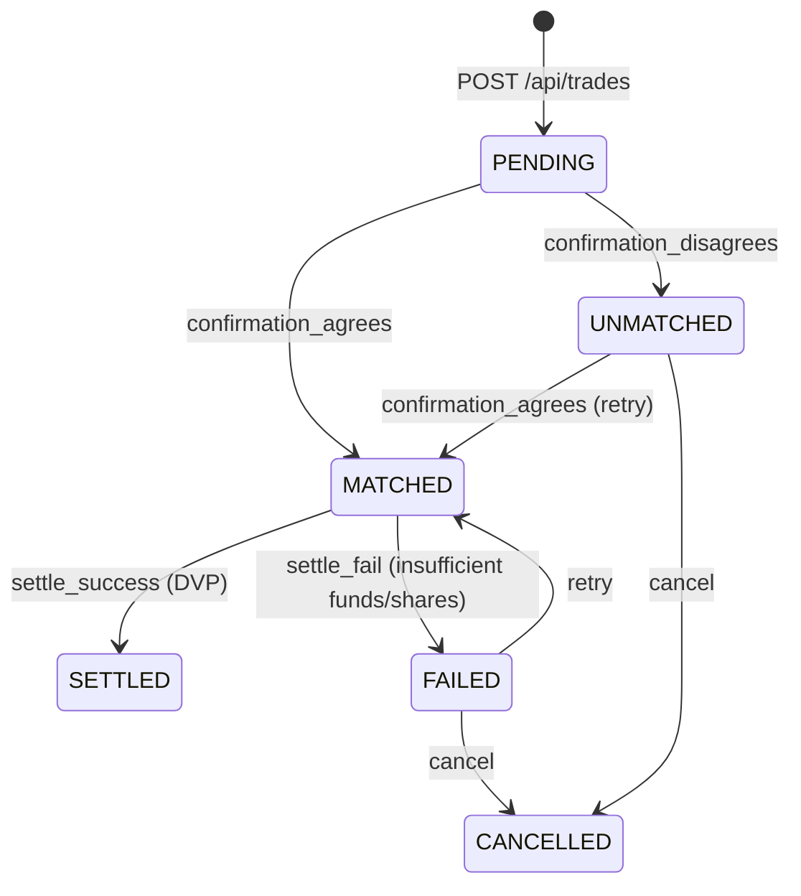

# Trade Settlement Simulator

A post-trade processing engine built with **Kotlin 2.3**, **Spring Boot 4.1.2**, **Spring Data JPA**, and **PostgreSQL**.

The application models a post-trade settlement lifecycle: capturing bilateral trades, matching against counterparty confirmations, executing atomic Delivery Versus Payment (DVP) settlement with double-entry ledger bookkeeping, and handling failure and cancellation recovery paths.

---

## Table of Contents

- [Overview & Domain Model](#overview--domain-model)
- [Trade Lifecycle & State Machine](#trade-lifecycle--state-machine)
- [Getting Started](#getting-started)
  - [Prerequisites](#prerequisites)
  - [Setup & Run Locally](#setup--run-locally)
  - [Running Tests](#running-tests)
  - [Pre-Seeded Demo Accounts](#pre-seeded-demo-accounts)
- [API Reference & Walkthrough (cURL)](#api-reference--walkthrough-curl)
  - [1. Check Initial Account Balances](#1-check-initial-account-balances)
  - [2. Capture a Trade](#2-capture-a-trade)
  - [3. Confirm Trade with Counterparty](#3-confirm-trade-with-counterparty)
  - [4. Settle the Trade](#4-settle-the-trade)
  - [5. Check Trade Status & Audit History](#5-check-trade-status--audit-history)
  - [6. Verify Updated Account Balances](#6-verify-updated-account-balances)
  - [7. Failure & Recovery Walkthrough](#7-failure--recovery-walkthrough)
- [Key Design Decisions](#key-design-decisions)
- [What I'd Do Next](#what-id-do-next)

---

## Overview & Domain Model

The system separates consistency boundaries into two primary aggregates rather than an over-engineered layer:

1. **Trade Aggregate (`trade.domain.Trade`)**
   - Consistency boundary for the trade lifecycle.
   - Enforces valid status transitions: `PENDING`, `MATCHED`, `UNMATCHED`, `SETTLED`, `FAILED`, and `CANCELLED`.
   - Rejects illegal state transitions with domain exceptions (`IllegalTradeTransitionException`), keeping controllers thin.
   - Records every state change as an immutable domain event (`TradeStatusChangedEvent`) persisted to `trade_status_history`.

2. **Ledger Aggregate (`ledger.domain.Account`, `ledger.domain.JournalEntry`)**
   - Consistency boundary for money and security asset movements.
   - Maintains balanced double-entry accounting: every settlement produces one `JournalEntry` containing balanced `Posting` records where total debits equal total credits.
   - Tracks cash accounts (by party and currency) and security accounts (by party and ISIN).

3. **Domain Value Objects**
   - `Money`: Exact `BigDecimal` amount and 3-letter ISO-4217 currency. Floating-point arithmetic is strictly avoided.
   - `Quantity`: Non-negative decimal instrument quantity.
   - `Isin`: 12-character international securities identification number.
   - `PartyId`: Alphanumeric party identifier.

---

## Trade Lifecycle & State Machine




- **Confirmation Matching**: When counterparty confirmations arrive, the aggregate compares side (must be opposite: our `BUY` matches counterparty `SELL`), ISIN, quantity, and price. Discrepancies move the trade to `UNMATCHED` with specific field mismatch reasons (`side_mismatch`, `price_mismatch`, etc.).
- **Settlement Execution**: Triggered via simulated custodian result API or the automated time-based scheduler.

---

## Getting Started

### Prerequisites

- **Java 17+** (JDK)
- **Docker & Docker Compose** (for local PostgreSQL and Testcontainers integration tests)

### Setup & Run Locally

1. **Configure Datasource Secret**
   The application and Docker Compose read database credentials using Spring Boot configuration trees from `./secrets/`:

   ```bash
   mkdir -p secrets
   echo -n "tss_password" > secrets/spring.datasource.password
   ```

2. **Start PostgreSQL Container**
   Start the Postgres database defined in `compose.yaml`:

   ```bash
   docker compose up -d
   ```

3. **Run the Application**
   Flyway runs database migrations automatically upon application startup:

   ```bash
   ./gradlew bootRun
   ```

   The application starts listening on `http://localhost:8080`.

### Running Tests

Run the full unit and integration test suite:

```bash
./gradlew test
```

> **Note:** Integration tests run against real PostgreSQL instances spun up automatically using **Testcontainers**. Docker must be running on your machine. You do not need to start `compose.yaml` to run tests.

### Pre-Seeded Demo Accounts

Flyway migration `V1__parties_and_accounts.sql` initializes test accounts to easily demonstrate successful and failed settlements:

| Party ID | Account Type | Currency / ISIN | Initial Balance | Purpose |
| :--- | :--- | :--- | :--- | :--- |
| `HOUSE-01` | `CASH` | `EUR` | `1,000,000.00` | House cash account (buyer cash) |
| `HOUSE-01` | `SECURITY` | `US0378331005` | `10,000.00` | House custody position (Apple Inc.) |
| `COUNTERPARTY-01` | `CASH` | `EUR` | `25,000.00` | Counterparty cash account |
| `COUNTERPARTY-01` | `SECURITY` | `US0378331005` | `500.00` | Counterparty custody position |

---

## API Reference & Walkthrough (cURL)

| Method | Endpoint | Description | Idempotency Supported |
| :--- | :--- | :--- | :---: |
| `POST` | `/api/trades` | Capture a new trade (`PENDING`) | Yes |
| `GET` | `/api/trades/{id}` | Get trade details and lifecycle history | No |
| `POST` | `/api/trades/{id}/confirmation` | Process counterparty trade confirmation | Yes |
| `POST` | `/api/trades/{id}/settlement-instruction-result` | Inbound custodian settlement result | Yes |
| `POST` | `/api/trades/{id}/retry` | Retry a `FAILED` trade (`MATCHED`) | Yes |
| `POST` | `/api/trades/{id}/cancel` | Cancel an `UNMATCHED` or `FAILED` trade | Yes |
| `GET` | `/api/accounts` | Inspect cash and security balances | No |

---

### 1. Check Initial Account Balances

Inspect the seeded balances before booking any trades:

```bash
curl -s http://localhost:8080/api/accounts | jq .
```

---

### 2. Capture a Trade

Capture a new trade where `HOUSE-01` buys 100 shares of Apple (`US0378331005`) at €150.00 each from `COUNTERPARTY-01`:

```bash
curl -i -X POST http://localhost:8080/api/trades \
  -H "Content-Type: application/json" \
  -H "Idempotency-Key: trade-capture-001" \
  -d '{
    "side": "BUY",
    "isin": "US0378331005",
    "quantity": 100.00,
    "price": 150.00,
    "currency": "EUR",
    "ourPartyId": "HOUSE-01",
    "counterpartyId": "COUNTERPARTY-01",
    "tradeDate": "2026-10-28",
    "settlementDate": "2026-10-29"
  }'
```

*Response `201 Created` with `Location: /api/trades/{tradeId}`. Status is `PENDING`.*

```json
{
  "id": "3fa85f64-5717-4562-b3fc-2c963f66afa6",
  "side": "BUY",
  "isin": "US0378331005",
  "quantity": 100.00,
  "price": 150.00,
  "currency": "EUR",
  "ourPartyId": "HOUSE-01",
  "counterpartyId": "COUNTERPARTY-01",
  "tradeDate": "2026-10-28",
  "settlementDate": "2026-10-29",
  "status": "PENDING",
  "version": 0,
  "history": [
    {
      "tradeId": "3fa85f64-5717-4562-b3fc-2c963f66afa6",
      "from": null,
      "to": "PENDING",
      "reason": "POST_trades",
      "occurredAt": "2026-10-28T15:00:00Z"
    }
  ]
}
```

> **Note:** If `settlementDate` is omitted, the engine defaults to `tradeDate + 1 day` (T+1 calendar days).

---

### 3. Confirm Trade with Counterparty

The counterparty sends their confirmation message. Since our side is `BUY`, their side must be `SELL`:

```bash
curl -i -X POST http://localhost:8080/api/trades/3fa85f64-5717-4562-b3fc-2c963f66afa6/confirmation \
  -H "Content-Type: application/json" \
  -H "Idempotency-Key: confirm-001" \
  -d '{
    "side": "SELL",
    "isin": "US0378331005",
    "quantity": 100.00,
    "price": 150.00,
    "currency": "EUR"
  }'
```

*Trade status transitions to `MATCHED` (`confirmation_agrees`).*

*(If the counterparty details do not match, e.g. `price: 155.00`, the status transitions to `UNMATCHED` with reason `price_mismatch`.)*

---

### 4. Settle the Trade

Settlement can take place through two mechanisms:

#### Option A: Simulated Custodian Settlement (REST API)
Simulate a custodian message confirming settlement execution:

```bash
curl -i -X POST http://localhost:8080/api/trades/3fa85f64-5717-4562-b3fc-2c963f66afa6/settlement-instruction-result \
  -H "Content-Type: application/json" \
  -H "Idempotency-Key: settle-001" \
  -d '{
    "result": "SETTLED",
    "reason": "settle_success"
  }'
```

#### Option B: Background Scheduled Processing
An automated job (`TradeSettlementJob`) runs periodically (configured via `app.settlement.fixed-delay-ms=60000`). It selects all trades in `MATCHED` status where `settlementDate <= today` and triggers `attemptSettlement(tradeId)`.

---

### 5. Check Trade Status & Audit History

Fetch the complete read model and transition history for the trade:

```bash
curl -s http://localhost:8080/api/trades/3fa85f64-5717-4562-b3fc-2c963f66afa6 | jq .
```

```json
{
  "id": "3fa85f64-5717-4562-b3fc-2c963f66afa6",
  "status": "SETTLED",
  "history": [
    { "from": null, "to": "PENDING", "reason": "POST_trades" },
    { "from": "PENDING", "to": "MATCHED", "reason": "confirmation_agrees" },
    { "from": "MATCHED", "to": "SETTLED", "reason": "settle_success" }
  ]
}
```

---

### 6. Verify Updated Account Balances

Confirm that double-entry ledger postings moved funds and securities atomically:

```bash
curl -s http://localhost:8080/api/accounts | jq .
```

*Results for a 100 shares @ €150.00 (€15,000 total) trade:*
- `HOUSE-01` CASH (EUR): `€1,000,000.00` → `€985,000.00` (-€15,000)
- `COUNTERPARTY-01` CASH (EUR): `€25,000.00` → `€40,000.00` (+€15,000)
- `HOUSE-01` SECURITY: `10,000.00` → `10,100.00` (+100 shares)
- `COUNTERPARTY-01` SECURITY: `500.00` → `400.00` (-100 shares)

---

### 7. Failure & Recovery Walkthrough

If the seller has insufficient securities or the buyer has insufficient cash at settlement time:
1. The trade transitions to `FAILED` with a specific failure reason (`insufficient_cash_balance` or `insufficient_security_balance`).
2. **Zero ledger entries or postings are created.**

#### Retrying a Failed Trade
Once accounts are funded or reconciled, retry the trade:

```bash
curl -i -X POST http://localhost:8080/api/trades/{tradeId}/retry \
  -H "Idempotency-Key: retry-001"
```
*Transitions from `FAILED` back to `MATCHED`.*

#### Cancelling a Trade
Cancel an `UNMATCHED` or `FAILED` trade:

```bash
curl -i -X POST http://localhost:8080/api/trades/{tradeId}/cancel \
  -H "Idempotency-Key: cancel-001"
```
*Transitions to `CANCELLED`.*

---

## Key Design Decisions

### 1. Why `Trade` is the Aggregate Root
The `Trade` entity is the consistency boundary for the entire post-trade lifecycle. State transitions (`confirm`, `settle`, `fail`, `retry`, `cancel`) are methods on the aggregate itself and throw domain exceptions (`IllegalTradeTransitionException`) on invalid moves. Controllers stay thin and never branch on status.

### 2. Why a History Table + Domain Events
Auditability is non-negotiable in financial operations. Every state change generates an in-memory `TradeStatusChangedEvent` that is persisted to `trade_status_history`. This creates an immutable, queryable audit trail (`from_status`, `to_status`, `reason`, `occurred_at`) returned directly by `GET /api/trades/{id}` without the complexity of an external event store.

### 3. Why REST Endpoints Stand In for Messaging
In production, confirmations and custodian settlement results arrive via message brokers (JMS, Kafka) or financial networks. In this simulator, REST endpoints serve as synchronous, easily testable adapters for those inbound messages while retaining identical domain behavior.

### 4. Atomic DVP (Delivery Versus Payment) Settlement
Settlement is executed within a `@Transactional` boundary in `SettlementService`. DVP guarantees that securities and cash move simultaneously or not at all:
- Checks both buyer cash and seller security balances before writing any postings.
- If balances are insufficient, records `FAILED` status on the trade with zero postings.
- If sufficient, creates one `JournalEntry` and four balanced `Posting` records (buyer cash debit, seller cash credit, seller security debit, buyer security credit) where total debits equal credits.
- A unique constraint on `journal_entries(trade_id)` guarantees that no trade can ever be settled or posted twice.

### 5. Idempotency Support
Mutating operations accept an optional `Idempotency-Key` header. Requests are stored in `idempotency_keys` along with a SHA-256 hash of the request payload:
- **Same key + same payload**: Safe replay returning the current resource state.
- **Same key + different payload**: Fails with `409 Conflict` to prevent accidental duplicate actions with conflicting parameters.

### 6. T+1 Calendar Days Default
If a client does not provide a `settlementDate` when creating a trade, the system defaults to `tradeDate + 1 day`, reflecting the current financial industry transition to T+1 settlement cycles.

---

## What I'd Do Next

If extending this system toward production readiness, the immediate architectural enhancements would be:

1. **Inbound Message Queuing (Kafka / RabbitMQ / JMS)**
   Replace simulated REST confirmation and custodian endpoints with message consumers handling standard post-trade formats (e.g. SWIFT MT515/MT541/MT543 or ISO 20022 `sese.023` / `pacs.008`).

2. **Holiday & Business-Day Settlement Calendars**
   Replace the simple calendar-day T+1 calculation with real market business-day calendars (e.g. TARGET2 for EUR, Fedwire for USD, exchange holidays) to roll settlement dates over weekends and bank holidays.

3. **Transactional Outbox Pattern**
   Persist emitted `TradeStatusChangedEvent` records to an `outbox` table in the same database transaction as the trade changes, with a CDC connector (Debezium) or poller relaying events reliably to downstream subscribers.

4. **Partial Settlement & Netting**
   Support partial fills and settlements when a party holds insufficient inventory to settle the full quantity, as well as multilateral end-of-day cash and securities netting.

5. **Authentication, Authorization & Multi-Tenancy**
   Implement mTLS or API token authentication for external counterparties and custodians, with role-based access control (RBAC) ensuring counterparties can only view or confirm trades in which they are a participant.

6. **Optimistic Locking Contention Handling**
   Account balances and trades already have `@Version` columns; add explicit retry strategies with exponential backoff for high-concurrency ledger debit contention during batch settlement.
